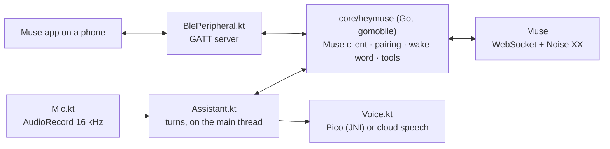

# AGENTS.md — guide for working on Hey Muse for Portal

## What this is

An Android app (Kotlin + Compose, minSdk 28, targetSdk 29, arm64 only) that makes a Meta Portal a
Muse gadget: it hears "Hey Muse", sends what was said to the owner's Muse as a voice note, and says
the answer. It is hey-muse with the Echo operating system (TECHO5) taken away: the Muse protocol,
pairing, wake word, endpointing, cloud voice and device tools are hey-muse's Go code, kept in `core/`
and bound into the APK with gomobile, the same split Wormhole Display has between its C core and its
Kotlin shell.



## Layout

```
core/                       Go module github.com/pgodlews/hey-muse/core
  heymuse/                  the gomobile API: App, Host, Peripheral, Ears, Speech (Java package `heymuse`)
  muse/, muse/pairing/      hey-muse's port of Meta's Muse Gadget SDK client and BLE setup (Apache-2.0)
  device/                   timers, alarms, volume, stop: what Muse may call ("portal.*" commands)
  wake/                     the "Hey Muse" microWakeWord model, embedded, run by zserge/microwakeword
  endpoint/                 when the speaker has finished (TECHO5's, unchanged)
  speech/                   OpenAI-style /audio/speech client (24 kHz PCM)
app/src/main/java/io/github/pgodlews/heymuse/
  Assistant.kt              the one owner: core, mic, voice, ring; the turn state machine; Host callbacks
  Mic.kt                    AudioRecord loop, privacy-switch/assistant silence detection, restarts
  Voice.kt                  cloud voice with built-in fallback, AudioTrack playback
  Pico.kt + cpp/pico_jni.c  SVOX Pico, the built-in voice
  BlePeripheral.kt          the Muse setup GATT service (heymuse.Peripheral)
  Sound.kt                  clips (chime, ring), the media-stream volume
  Avatar.kt                 Muse's character from owner-made sprite sheets
  MainActivity.kt, HomeScreen.kt, SettingsScreen.kt   the screen
  MuseService.kt, BootReceiver.kt                     background listening, start on boot
scripts/build-core.sh       gomobile bind → app/libs/heymuse-core.aar (Gradle's preBuild runs it)
tools/muse-avatar/          makes the character's sprite sheets from the owner's own SDK checkout
```

## Rules

- **Threads.** The core calls `Host` from its own goroutines. `Assistant` posts every callback to the
  main thread and never calls back into the core from inside one: `App.cancelTurn` waits for the turn
  goroutine, which may be inside a callback. Ears are used only on the mic thread.
- **One Ask at a time.** Muse does not say which question an answer belongs to. `App.askVoice` cancels
  the previous turn first; turn numbers let the app drop late events of an old turn.
- **Never advertise `device.ota`**, and never register with device family "link": Muse pushes ESP32
  firmware to those. `core/muse` refuses both; keep it that way.
- **Secrets.** The SDK token, the speech key and the pairing tokens never go to a log, a screenshot,
  a test fixture or a release. Test data is made up.
- **The character is Meta's.** Neither it nor the code that draws Meta's renderer belongs in this
  repository or the APK. `Avatar.kt` only plays sheets the owner made.
- **Tests.** `go test -race ./...` in `core/` must pass. The app has no instrumented tests; anything
  that can be decided without Android belongs in `core/` where it can be tested.

## The Portal

What another Portal app (a Gemini Live client) found, which this app follows:

| | |
|---|---|
| CPU | Every model is arm64-v8a: Portal+ Gen 1 and Portal Gen 1 (SDA660, Android 9), Portal+ Gen 2, Portal, Mini, Go (QCS605, Android 10). |
| Microphone | `VOICE_COMMUNICATION` goes through the DSP: 4-mic beam, noise suppression, AGC, AEC. 16 kHz mono works directly. `MIC` is the fallback; `UNPROCESSED` is refused. |
| Silence | The privacy switch, and "Hey Portal"/Alexa while active, make reads return all zeros, not errors. After an assistant session a read may fail with -3; make the recorder again. |
| Background | A foreground service plus a partial wake lock keeps the mic open under the screen saver. The microphone service type only exists from API 30. |
| Echo | Hardware AEC is good up to roughly 70% volume. The app does not listen while it speaks. |
| Playback | `USAGE_MEDIA` keeps the speakers' full range; the volume rocker moves `STREAM_MUSIC`. |
| Bluetooth | `BluetoothLeAdvertiser` and `openGattServer` work; Bluetooth may need turning on. |
| Permissions | `adb install -g` pre-grants the microphone; the dialog can hide behind full screen. |

## Pairing without the Portal's Bluetooth

If a Portal cannot advertise, pair from a Linux computer with Bluetooth using hey-muse's own
`musepair` (in [hey-muse](https://github.com/wobsoriano/hey-muse), `echod/cmd/musepair`; see its
docs/muse.md), which writes a `muse.json`. Then:

```sh
adb push muse.json /sdcard/Android/data/io.github.pgodlews.heymuse/files/muse.json
adb shell am force-stop io.github.pgodlews.heymuse
adb shell am start -n io.github.pgodlews.heymuse/.MainActivity
```

The app takes the pairing into its private storage at start and deletes the pushed copy. Do not
leave a `muse.json` anywhere else: its tokens are the Portal's whole identity with Muse.

## Building and releasing

- `scripts/build.sh` builds a debug APK into `dist/`. Gradle's `buildCore` task runs
  `scripts/build-core.sh`, which installs the gomobile version `core/go.mod` names into `.tools/`.
- CI (`.github/workflows/build.yml`) tests the core and builds an APK on every push. Pushes to `main`
  publish a signed rolling `latest` pre-release; `vX.Y.Z` tags publish releases. Signing needs the
  secrets `HEYMUSE_KEYSTORE_BASE64`, `HEYMUSE_KEYSTORE_PASSWORD`, `HEYMUSE_KEY_ALIAS` and
  `HEYMUSE_KEY_PASSWORD`; without them, branch builds are debug-signed and publishing refuses.
